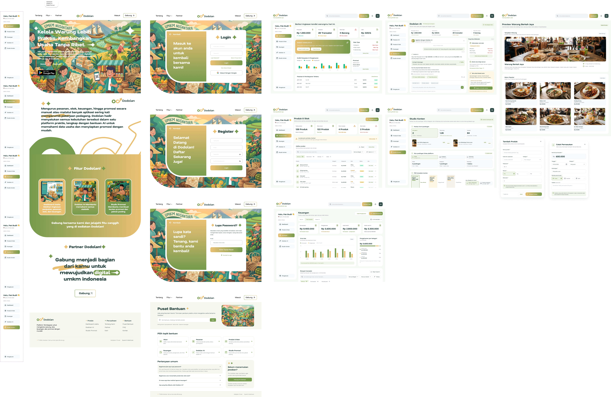
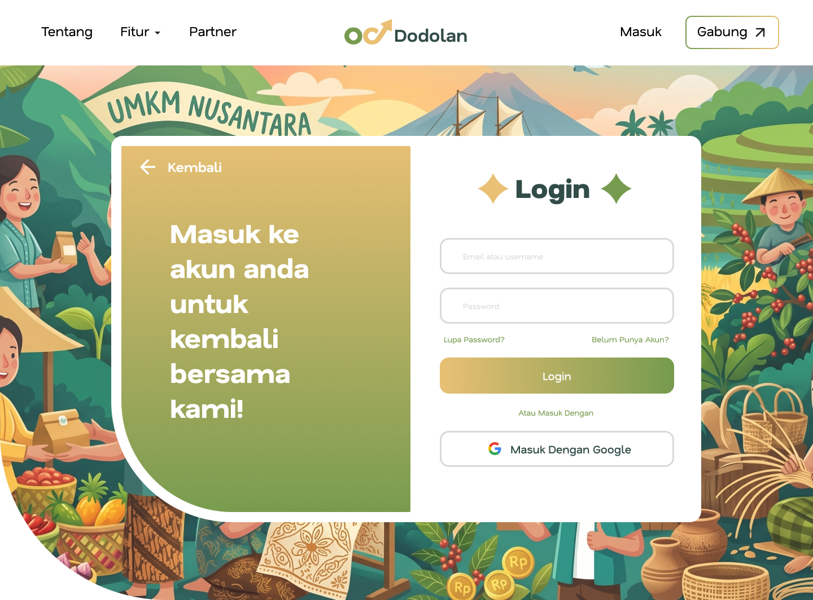
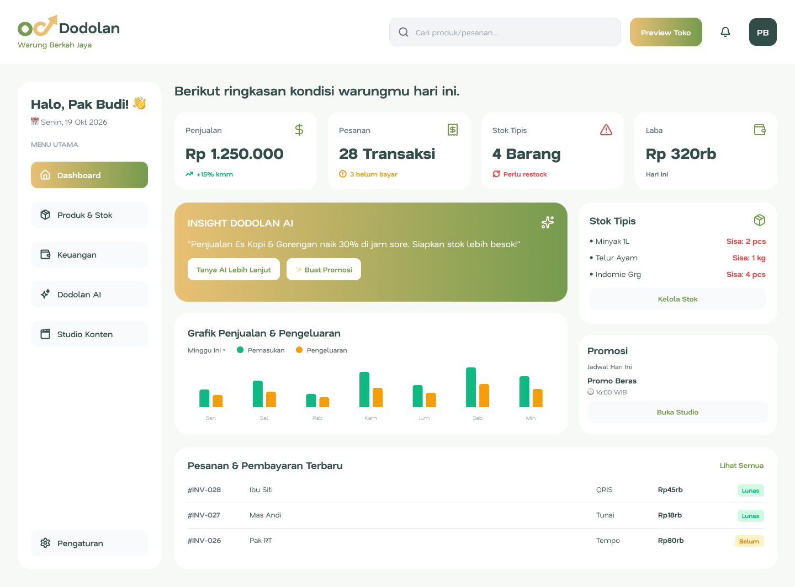
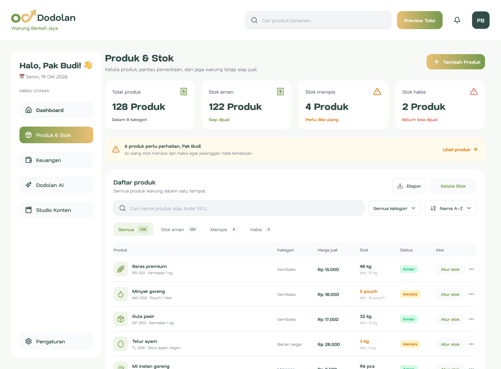
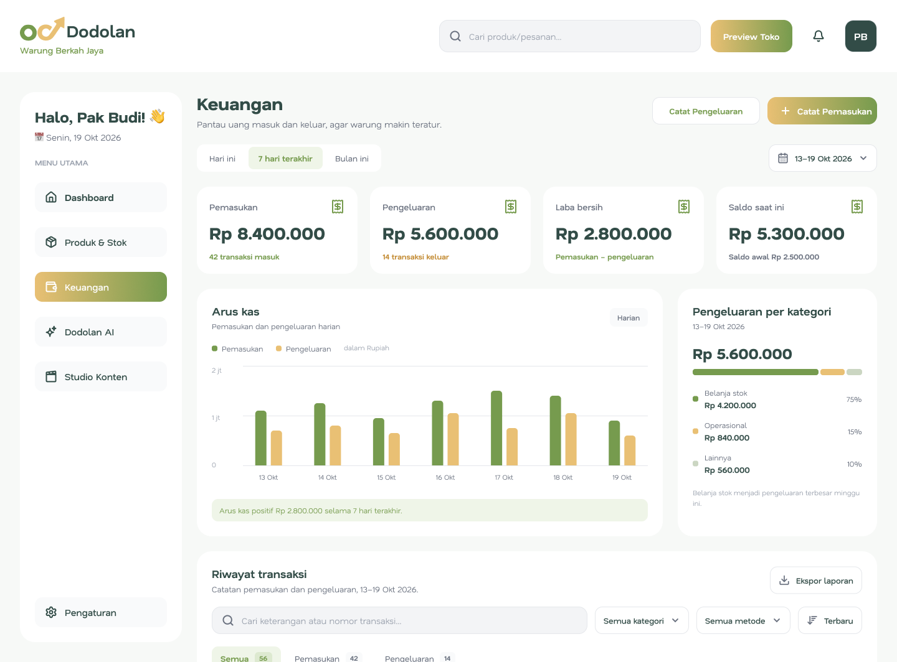
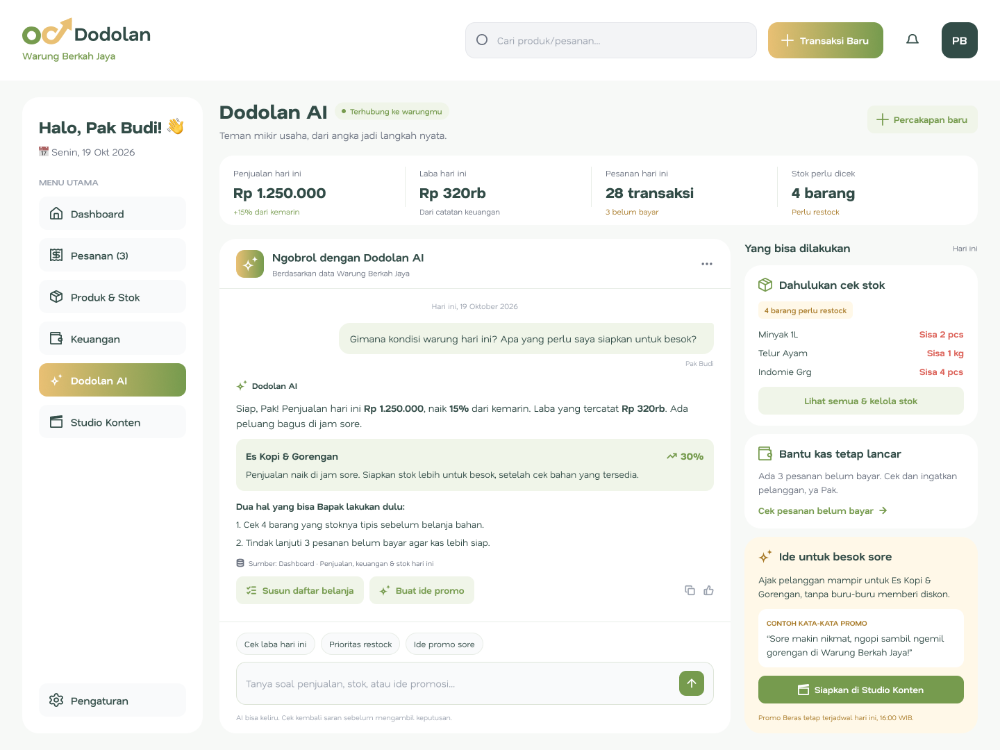
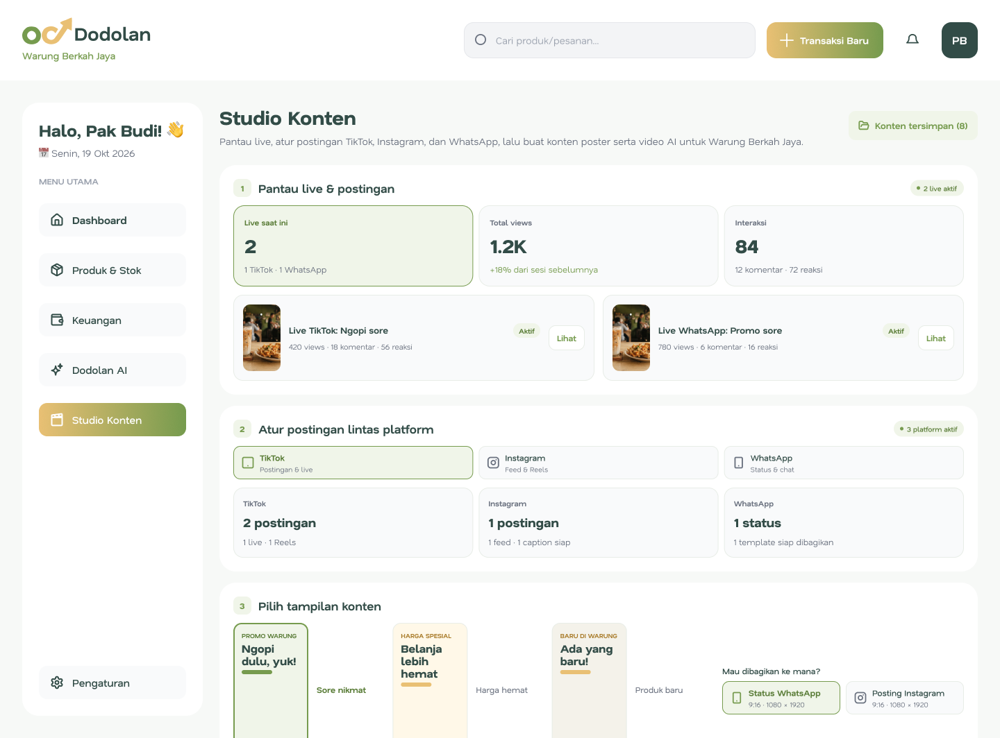
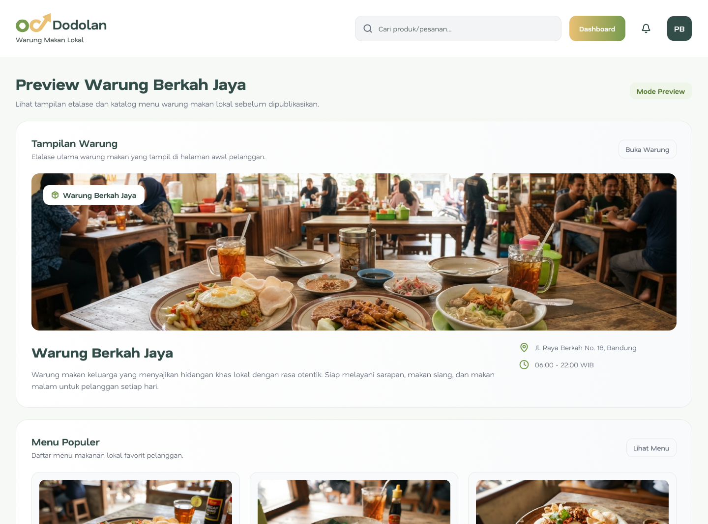

. 
# Dodolan — Platform Terintegrasi Pengelolaan Warung & UMKM Nusantara
> **Kelola Warung Lebih Praktis, Kembangkan Usaha Tanpa Ribet.**  
> Karya ini diajukan untuk **Lomba UI/UX Design INTECFEST (SINTECHFEST) 2026** — *"Digital Evolution: From Ideas to Innovation"*

*(Catatan: Gambar di atas adalah preview dari ui website Dodolan)*

---

## 🔗 Tautan Penting (Quick Links)
* 🎨 **[Buka Prototipe Interaktif (Figma Prototype)](https://www.figma.com/proto/HkGjb4f4MXoSSZpFe4Qs4d/Dodolan?node-id=91-7251&p=f&t=eft233KIKNyzHcDQ-1&scaling=scale-down&content-scaling=fixed&page-id=0%3A1)** *(Akses Publik)*
* 📐 **[Buka File Desain (Figma View)](https://www.figma.com/design/HkGjb4f4MXoSSZpFe4Qs4d/Dodolan?node-id=91-7255&t=KRUOzYjslYBw0Zh3-1)**
* 📄 **[Unduh Poster / Frame Utama (PDF)](./poster.pdf)** *(Sesuaikan dengan nama file PDF kamu)*

---

## 👤 Identitas Peserta
* **Nama Peserta:** Resta Nugroho
* **Asal Instansi:** Universitas Islam Negeri (UIN) Salatiga
* **Cabang Lomba:** UI/UX Design Competition — INTECFEST 2026
* **Nama Aplikasi UMKM:** Dodolan

---

## 💡 Latar Belakang Masalah & Solusi

### Latar Belakang Masalah
Mengurus pesanan, memantau ketersediaan stok barang, mencatat arus kas keuangan, hingga membuat materi promosi secara manual atau melalui terlalu banyak aplikasi yang terpisah sering kali memperumit pekerjaan pedagang warung dan pelaku UMKM. Banyak pemilik warung kesulitan mengetahui produk mana yang hampir habis, menghitung laba bersih harian secara akurat, serta menjangkau pelanggan digital karena keterbatasan waktu dan keahlian membuat konten promosi.

### Solusi yang Ditawarkan
**Dodolan** hadir sebagai satu platform web terintegrasi yang menyatukan seluruh kebutuhan operasional warung dan UMKM Nusantara. Dirancang dengan antarmuka (*User Interface*) yang bersih, ramah pengguna, dan berbahasa sehari-hari yang mudah dipahami pedagang, Dodolan membantu pemilik usaha mulai dari memantau stok *real-time*, menerima pembayaran digital (QRIS/Transfer/Tunai), mencatat laporan keuangan otomatis, berkonsultasi strategi usaha lewat asisten pintar **Dodolan AI**, hingga mengelola promosi lintas platform melalui **Studio Konten**.

---

## ✨ Daftar Fitur Utama & Cara Penggunaan (User Flow)

### 1. Halaman Utama (Landing Page), Autentikasi & Pusat Bantuan
* **Fungsi:** Mengenalkan fitur utama Dodolan kepada calon pengguna baru, menyediakan akses masuk/pendaftaran akun yang mudah, serta panduan kendala teknis di Pusat Bantuan.
* **Cara Penggunaan (Alur):**
  `Landing Page Dodolan` ➔ Klik `Gabung / Masuk` ➔ Pilih `Login` (Email/Google), `Register` (Daftar Akun Baru), atau `Lupa Password` ➔ Masuk ke halaman utama aplikasi (`Dashboard`). Pengguna juga dapat mengakses menu `Bantuan` untuk mencari panduan berdasarkan topik atau FAQ.
. 

### 2. Dashboard Usaha (Ringkasan Harian Warung)
* **Fungsi:** Menampilkan ringkasan performa warung hari ini secara sekilas, meliputi total penjualan, jumlah transaksi, peringatan stok tipis, laba bersih, grafik penjualan & pengeluaran mingguan, daftar pesanan terbaru (QRIS/Tunai/Tempo), serta *insight* otomatis dari Dodolan AI.
* **Cara Penggunaan (Alur):**
  Buka menu `Dashboard` di bilah sisi kiri ➔ Pantau metrik ringkasan harian & grafik arus kas ➔ Cek kartu `Stok Tipis` untuk langsung mengatur stok ➔ Klik tombol `+ Transaksi Baru` di bagian atas untuk mencatat penjualan baru.
  . 

### 3. Manajemen Produk & Stok (`Produk & Stok`)
* **Fungsi:** Mengelola seluruh katalog produk warung beserta status ketersediaannya (*Stok Aman*, *Stok Menipis*, *Stok Habis*) lengkap dengan kode SKU, kategori, dan harga jual agar pedagang tidak kehabisan barang laris.
* **Cara Penggunaan (Alur):**
  Buka menu `Produk & Stok` ➔ Filter atau cari barang melalui kolom pencarian/kategori ➔ Klik tombol `+ Tambah Produk` ➔ Isi formulir modal *Tambah Produk* (Nama produk, Kode SKU, Kategori, Harga jual, Satuan, Stok awal) ➔ Klik `Simpan Produk`.
  .

### 4. Pencatatan & Laporan Keuangan (`Keuangan`)
* **Fungsi:** Mencatat dan memantau uang masuk serta uang keluar agar pembukuan warung tetap rapi. Dilengkapi ringkasan pemasukan, pengeluaran, laba bersih, grafik arus kas harian, persentase pengeluaran per kategori, serta tabel riwayat transaksi yang bisa diekspor.
* **Cara Penggunaan (Alur):**
  Buka menu `Keuangan` ➔ Pilih filter periode (`Hari ini`, `7 hari terakhir`, `Bulan ini`) ➔ Klik tombol `+ Catat Pemasukan` atau `Catat Pengeluaran` ➔ Masukkan nominal, tanggal, kategori, keterangan, dan metode pembayaran (`Tunai`, `Transfer`, `QRIS`) ➔ Klik `Simpan Pemasukan` atau klik `Ekspor Laporan` untuk mengunduh rekapitulasi.
  . 

### 5. Asisten Usaha Pintar (`Dodolan AI`)
* **Fungsi:** Teman pintar usaha untuk membantu pedagang memahami statistik penjualan tanpa pusing membaca angka rumit. Memberikan analisis lonjakan penjualan, pengingat barang yang wajib dibeli sebelum belanja stok, pengingat piutang/pesanan belum lunas, serta rekomendasi ide promo.
* **Cara Penggunaan (Alur):**
  Buka menu `Dodolan AI` ➔ Ketik pertanyaan di kolom obrolan atau pilih tombol cepat (*"Cek laba hari ini"*, *"Prioritas restock"*, *"Ide promo sore"*) ➔ Lihat analisis instan beserta daftar rekomendasi tindakan (`Yang bisa dilakukan`) di panel sebelah kanan.
  . 

### 6. Studio Konten & Promosi Lintas Platform (`Studio Konten`)
* **Fungsi:** Membantu pedagang membuat konten promosi menggunakan *template* siap pakai, memantau performa *live streaming*, dan menjadwalkan *posting* otomatis ke TikTok, Instagram, serta Status WhatsApp dari satu tempat.
* **Cara Penggunaan (Alur):**
  Buka menu `Studio Konten` ➔ Pantau performa di bagian `Pantau live & postingan` ➔ Pilih desain di bagian `Pilih tampilan konten` (*Template* Promo/Produk Baru) ➔ Pilih saluran distribusi (`Status WhatsApp` / `Posting Instagram`) atau klik `+ Jadwal baru` pada bagian `Atur postingan lintas platform`.
  . 

### 7. Pratinjau Katalog Digital Warung (`Preview Toko`)
* **Fungsi:** Menampilkan halaman katalog digital warung (contoh: *Warung Berkah Jaya*) sebagaimana dilihat oleh pelanggan, lengkap dengan informasi alamat, jam operasional, status buka/tutup, serta daftar menu populer beserta harganya.
* **Cara Penggunaan (Alur):**
  Klik tombol `Preview Toko` pada bagian navigasi atas (*header*) ➔ Tinjau tampilan informasi warung dan etalase `Menu Populer` sebelum dipublikasikan ke pelanggan.
  . 

---

## 🎨 Sistem Desain (Design System) & Penerapan Prinsip UI/UX

### 1. Palet Warna (Color Palette)
Menggunakan perpaduan warna Hijau Zambrud (*Emerald Forest*) dan Aksen Kuning Keemasan (*Warm Gold*) yang merepresentasikan pertumbuhan usaha, kesegaran, serta kehangatan UMKM Nusantara, dipadukan dengan warna permukaan terang agar tabel dan grafik mudah dibaca.

| Peran Warna | Pratinjau & Kode Hex | Penggunaan pada Antarmuka (UI) |
| :--- | :---: | :--- |
| **Primary Dark Green** |  `#1F4E3D` | Warna identitas utama, *hero section*, tombol aksi utama (*Primary CTA*), dan kartu *highlight*. |
| **Secondary Sage Green** |  `#4E8752` | Grafik batang pemasukan, status *Stok Aman*, *badge* positif, dan aksen pendukung. |
| **Accent Warm Gold** |  `#E5B84B` | *Menu active state* pada *Sidebar*, tombol *Preview Toko*, dan aksen penarik perhatian (*focal point*). |
| **Semantic Status** |   | Indikator visual *Stok Menipis* (Kuning/Oranye) dan *Stok Habis* / Pengeluaran (Merah). |
| **Neutral & Surface** |   | Latar belakang aplikasi (`#F8F9FA`), permukaan kartu putih bersih (`#FFFFFF`), dan teks utama kontras tinggi. |

---

### 2. Tipografi & Hierarki Visual (Typography)
* **Keterbacaan Tinggi (*High Readability*):** Menggunakan jenis huruf *Sans-Serif* modern untuk seluruh metrik angka, tabel stok, dan laporan keuangan agar pedagang dapat memindai nominal rupiah (`Rp`) serta jumlah barang secara cepat tanpa lelah mata.
* **Kontras Ukuran yang Jelas:** Membedakan secara tegas antara ukuran *Heading* (judul halaman & total saldo), *Body Text* (nama barang & riwayat transaksi), serta *Caption/Label* (status pembayaran QRIS/Tunai/Tempo).

---

### 3. Prinsip UX & Usability yang Diterapkan
* 🧭 **Konsistensi Navigasi (*Consistent Sidebar Navigation*):** Seluruh modul utama (*Dashboard, Produk & Stok, Keuangan, Dodolan AI, Studio Konten*) ditempatkan pada bilah navigasi kiri yang selalu tetap (*fixed*), memudahkan pengguna berpindah halaman hanya dalam 1 klik.
* ⚡ **Efisiensi Alur Pengguna (*Streamlined User Flow*):** Proses krusial seperti **+ Tambah Produk** dan **+ Catat Pemasukan** menggunakan komponen *Modal Pop-up* di halaman yang sama, sehingga pengguna tidak kehilangan konteks halaman saat menginput data.
* 💬 **UX Writing yang Ramah & Kontekstual:** Menggunakan sapaan personal (*"Halo, Pak Budi!"*) dan bahasa sehari-hari pedagang warung, bukan istilah akuntansi atau teknis yang rumit, sehingga ramah bagi pengguna dari berbagai kalangan usia.
* 📊 **Visualisasi Data Intuitif:** Mengubah angka pembukuan yang rumit menjadi kartu ringkasan (*summary cards*), indikator warna status stok, dan rangkuman kalimat otomatis lewat fitur **Dodolan AI**.
